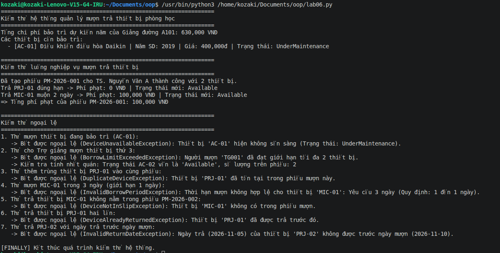
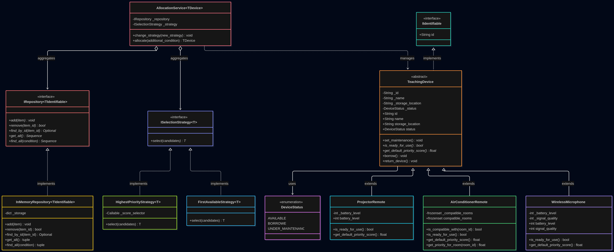
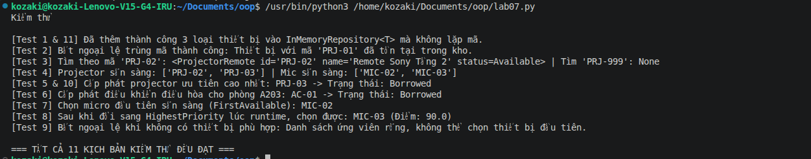
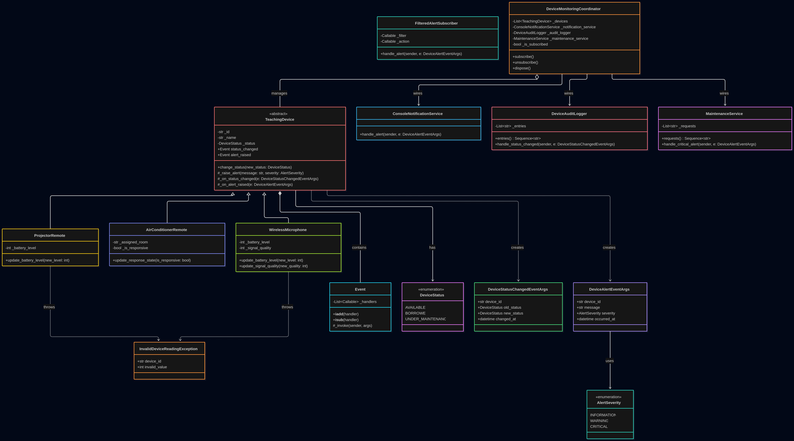
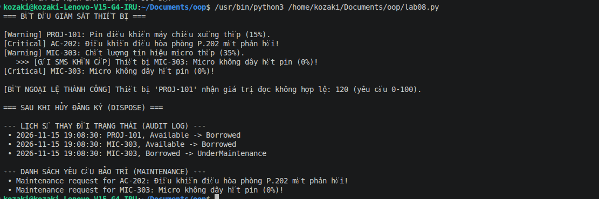
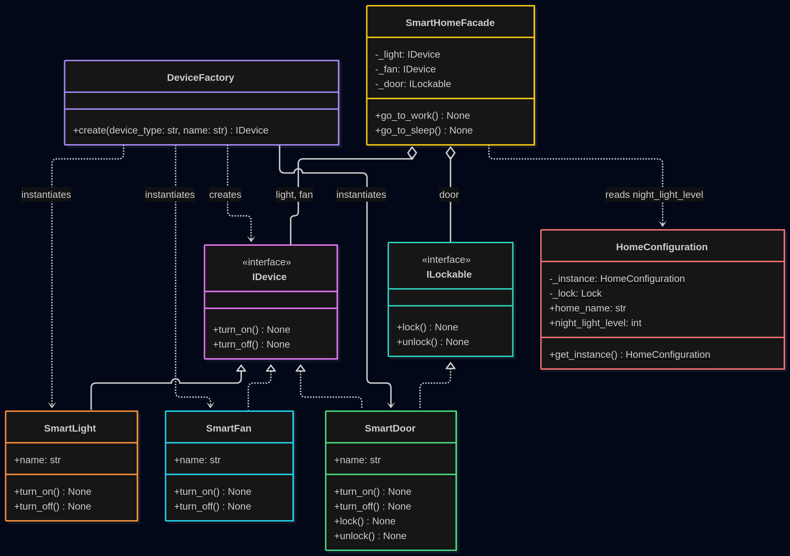
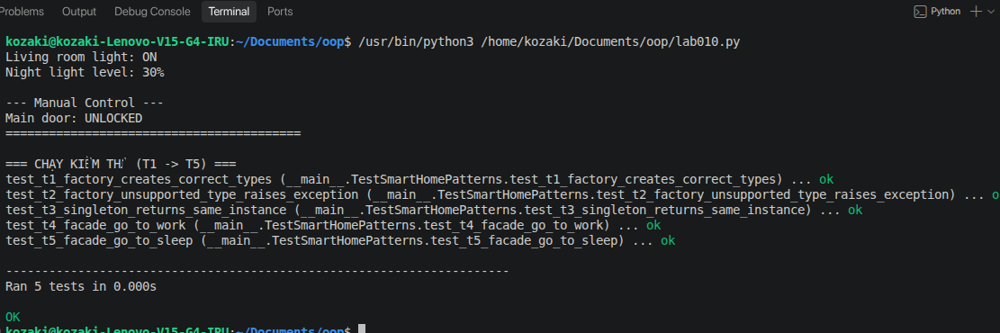

Do tài khoản Microsoft của em gặp vấn đề đăng nhập từ ngày 10/10/2026 dẫn tới việc em không thể lấy đề bài & nộp bài, đến sáng ngày 14/11/2026 em mới thiết lập lại mật khẩu và lấy lại quyền truy cập, nên em xin phép cho em nộp bài từ lab06 -> lab10 trong 1 bài ạ.

Vũ Bảo Khôi - 202419071
# lab06

## 1. Link github

https://github.com/chefkozaki/oop/blob/main/lab06.py

## 2. Danh sách các lớp và thành phần hệ thống

### 2.1. Nhóm Enum & thiết bị 
* **`DeviceStatus` (`Enum`)**: Định nghĩa các trạng thái của thiết bị bao gồm `AVAILABLE`, `BORROWED`, `UNDER_MAINTENANCE`, và `RETIRED`.
* **`Device` (`Abstract Class`)**: Lớp cơ sở trừu tượng chứa thông tin chung (`device_id`, `name`, `year_in_use`, `purchase_price`, `status`). Ràng buộc tính bất biến của mã thiết bị và định nghĩa phương thức trừu tượng `calculate_annual_maintenance_cost()`, `get_daily_late_fee()`.
* **`AirConditionerRemote` (`Concrete Class`)**: Kế thừa `Device`. Cài đặt công thức tính phí bảo trì năm (`5% giá mua + 50.000đ`) và phí trễ hạn (`20.000đ/ngày`).
* **`Microphone` (`Concrete Class`)**: Kế thừa `Device`. Cài đặt công thức tính phí bảo trì năm (`12% giá mua + 150.000đ`) và phí trễ hạn (`50.000đ/ngày`).
* **`ProjectorRemote` (`Concrete Class`)**: Kế thừa `Device`. Cài đặt công thức tính phí bảo trì năm (`8% giá mua + 70.000đ`) và phí trễ hạn (`30.000đ/ngày`).

### 2.2. Nhóm quản lý phòng học & nghiệp vụ mượn trả
* **`ClassRoom` (`Class`)**: Quản lý danh sách thiết bị theo quan hệ kết tập. Tính tổng chi phí bảo trì bằng tính đa hình và lọc danh sách thiết bị cần bảo trì (`> 5 năm` sử dụng hoặc đang `UNDER_MAINTENANCE`).
* **`IBorrower` (`Interface - ABC`)**: Giao diện quy định thông tin người mượn (`borrower_id`, `full_name`) và giới hạn số lượng thiết bị được mượn (`get_maximum_devices()`).
* **`Lecturer` (`Concrete Class`)**: Thực thi `IBorrower`. Giảng viên được phép mượn tối đa **3 thiết bị** trên một phiếu.
* **`TeachingAssistant` (`Concrete Class`)**: Thực thi `IBorrower`. Trợ giảng được phép mượn tối đa 2 thiết bị trên một phiếu.
* **`BorrowItem` (`Class`)**: Đại diện cho từng dòng thiết bị được mượn trong phiếu (ngày mượn, hạn trả, tiết mượn, ngày trả thực tế, tính phí phạt).
* **`BorrowingSlip` (`Class`)**: Phiếu mượn thiết bị, quản lý tập hợp các `BorrowItem` theo quan hệ hợp thành. Đảm bảo tính nhất quán dữ liệu khi thêm/trả thiết bị.

### 2.3. Hệ phân cấp ngoại lệ nghiệp vụ
* **`BorrowingException`** *(kế thừa `Exception`)*: Ngoại lệ cơ sở cho toàn bộ lỗi nghiệp vụ mượn trả.
* **`DeviceUnavailableException`** *(kế thừa `BorrowingException`)*: Phát sinh khi thiết bị không ở trạng thái `AVAILABLE` lúc mượn.
* **`BorrowLimitExceededException`** *(kế thừa `BorrowingException`)*: Phát sinh khi người mượn vượt quá số lượng thiết bị tối đa cho phép.
* **`InvalidBorrowPeriodException`** *(kế thừa `BorrowingException`)*: Phát sinh khi số ngày mượn $\le 0$ hoặc vượt quá giới hạn ngày tối đa của thiết bị.
* **`DuplicateDeviceException`** *(kế thừa `BorrowingException`)*: Phát sinh khi thêm trùng một thiết bị đã có sẵn trong cùng phiếu mượn.
* **`DeviceNotInSlipException`** *(kế thừa `BorrowingException`)*: Phát sinh khi yêu cầu trả một thiết bị không thuộc phiếu mượn hiện tại.
* **`DeviceAlreadyReturnedException`** *(kế thừa `BorrowingException`)*: Phát sinh khi yêu cầu trả một thiết bị đã được trả trước đó.
* **`InvalidReturnDateException`** *(kế thừa `BorrowingException`)*: Phát sinh khi ngày trả thiết bị nhỏ hơn ngày mượn.

## 3. Sơ đồ quan hệ lớp

## 4. Kết quả kiểm thử

# lab07

## 1. Link github

https://github.com/chefkozaki/oop/blob/main/lab07.py

## 2. Danh sách các lớp và Interface trong hệ thống

### 2.1. Nhóm Enum & ngoại lệ 
* **`DeviceStatus` (Enum):** Định nghĩa 3 trạng thái vòng đời của thiết bị gồm `AVAILABLE`, `BORROWED`, và `UNDER_MAINTENANCE`.
* **`DuplicateIdException`:** Ngoại lệ ném ra khi thêm thiết bị có mã `id` đã tồn tại trong kho.
* **`NoSuitableItemException`:** Ngoại lệ ném ra khi không tìm thấy thiết bị nào thỏa mãn điều kiện cấp phát hoặc danh sách ứng viên rỗng.
* **`DeviceNotReadyException`:** Ngoại lệ ném ra khi thực hiện thao tác `borrow()`, `return_device()` hoặc `set_maintenance()` không hợp lệ với trạng thái hiện tại của thiết bị.

### 2.2. Nhóm thiết bị
* **`IIdentifiable` (Protocol / Interface):** Quy định thuộc tính `id: str` giúp các cấu trúc tổng quát định danh và tìm kiếm đối tượng mà không phụ thuộc lớp cụ thể.
* **`TeachingDevice` (Abstract Base Class):** Lớp cơ sở trừu tượng cài đặt các thuộc tính chung (`id`, `name`, `storage_location`, `status`), các phương thức quản lý vòng đời (`borrow()`, `return_device()`, `set_maintenance()`) và khai báo 2 phương thức trừu tượng đa hình: `is_ready_for_use()` và `get_default_priority_score()`.
* **`ProjectorRemote` (Kế thừa `TeachingDevice`):** Quản lý điều khiển máy chiếu với thuộc tính `battery_level` (0–100). Sẵn sàng khi `Available` và pin $\ge 20\%$; điểm ưu tiên bằng `battery_level`.
* **`AirConditionerRemote` (Kế thừa `TeachingDevice`):** Quản lý điều khiển điều hòa với tập hợp phòng tương thích `compatible_rooms`. Sẵn sàng khi `Available`; cung cấp phương thức kiểm tra `is_compatible_with(room_id)`.
* **`WirelessMicrophone` (Kế thừa `TeachingDevice`):** Quản lý micro không dây với `battery_level` và `signal_quality` (0–100). Sẵn sàng khi `Available`, pin $\ge 30\%$ và tín hiệu $\ge 40\%$; điểm ưu tiên bằng trung bình cộng của pin và tín hiệu.

### 2.3. Nhóm kho lưu trữ & dịch vụ cấp phát
* **`IRepository[TIdentifiable]` (Generic Interface):** Định nghĩa các thao tác CRUD và lọc dữ liệu (`add`, `remove`, `find_by_id`, `get_all`, `find_all`) với ràng buộc kiểu `TIdentifiable` phải tuân thủ `IIdentifiable`.
* **`InMemoryRepository[TIdentifiable]`:** Cài đặt kho lưu trữ trên bộ nhớ bằng `dict[str, TIdentifiable]` cho phép truy xuất theo mã với độ phức tạp $O(1)$ và trả về `tuple` bất biến để bảo vệ dữ liệu nội bộ.
* **`ISelectionStrategy[T]` (Generic Interface):** Định nghĩa hợp đồng thuật toán chọn 1 phần tử tốt nhất từ danh sách ứng viên thông qua `select(candidates)`.
* **`HighestPriorityStrategy[T]`:** Chiến lược chọn phần tử có điểm cao nhất dựa trên hàm tính điểm `score_selector` truyền vào từ bên ngoài.
* **`FirstAvailableStrategy[T]`:** Chiến lược chọn phần tử hợp lệ đầu tiên xuất hiện trong danh sách ứng viên.
* **`AllocationService[TDevice]` :** Lớp điều phối trung tâm kết hợp `IRepository[TDevice]` và `ISelectionStrategy[TDevice]` để lọc thiết bị sẵn sàng, áp dụng điều kiện bổ sung, chọn thiết bị bằng chiến lược hiện tại và chuyển trạng thái sang `Borrowed`.

## 3. Sơ đồ lớp 

## 4. Kết quả kiểm thử

# lab08

## 1. Link github
https://github.com/chefkozaki/oop/blob/main/lab08.py

## 2. Danh sách lớp

### 2.1. Danh sách các lớp trong hệ thống

#### Nhóm Enum & ngoại lệ
* **`DeviceStatus`:** Định nghĩa các trạng thái hoạt động của thiết bị (`Available`, `Borrowed`, `UnderMaintenance`).
* **`AlertSeverity`:** Định nghĩa các mức độ nghiêm trọng của cảnh báo (`Information`, `Warning`, `Critical`).
* **`InvalidDeviceReadingException`:** Ngoại lệ phát sinh khi giá trị pin hoặc chất lượng tín hiệu nằm ngoài khoảng cho phép `[0, 100]`.

#### Nhóm cơ chế & dữ liệu sự kiện 
* **`Event`:** Lớp mô phỏng cơ chế `EventHandler` (hỗ trợ toán tử `+=`, `-=` để đăng ký/hủy đăng ký handler, ngăn chặn trùng lặp và bảo vệ quyền phát sinh sự kiện).
* **`DeviceStatusChangedEventArgs`:** Đóng gói dữ liệu khi thiết bị đổi trạng thái (`DeviceId`, `OldStatus`, `NewStatus`, `ChangedAt`).
* **`DeviceAlertEventArgs`:** Đóng gói dữ liệu khi thiết bị phát sinh cảnh báo (`DeviceId`, `Message`, `Severity`, `OccurredAt`).

#### Nhóm thiết bị
* **`TeachingDevice`:** Lớp trừu tượng cơ sở quản lý thông tin chung (`Id`, `Name`, `Status`) và chứa hai sự kiện `StatusChanged`, `AlertRaised`.
* **`ProjectorRemote`:** Kế thừa `TeachingDevice`, quản lý mức pin điều khiển máy chiếu (cảnh báo `Warning` khi `< 20%`, `Critical` khi `0%`).
* **`AirConditionerRemote`:** Kế thừa `TeachingDevice`, quản lý trạng thái phản hồi của điều khiển điều hòa theo phòng (cảnh báo `Critical` khi mất phản hồi).
* **`WirelessMicrophone`:** Kế thừa `TeachingDevice`, quản lý mức pin (`Warning` `< 30%`, `Critical` `0%`) và chất lượng tín hiệu (`Warning` `< 40%`, `Critical` `0%`).

#### Nhóm dịch vụ lắng nghe & điều phối
* **`ConsoleNotificationService`:** Lắng nghe `AlertRaised` và in thông báo cảnh báo ra màn hình console.
* **`DeviceAuditLogger`:** Lắng nghe `StatusChanged` và lưu vết lịch sử thay đổi trạng thái vào danh sách chỉ đọc.
* **`MaintenanceService`:** Lắng nghe `AlertRaised` và tự động tạo phiếu yêu cầu bảo trì nếu cảnh báo ở mức `Critical`.
* **`FilteredAlertSubscriber`:** Sử dụng delegate (`AlertFilter` và `Action`) để lọc sự kiện theo điều kiện tùy chỉnh trước khi thực thi hành động.
* **`DeviceMonitoringCoordinator`:** Lớp điều phối việc đăng ký (`subscribe`) và hủy đăng ký (`unsubscribe` / `dispose`) hàng loạt giữa danh sách thiết bị và các dịch vụ.

## 3. Sơ đồ lớp

## 4. Kết quả kiểm thử

# lab10

## 1. Link github
https://github.com/chefkozaki/oop/blob/main/lab010.py
## 2. Danh sách lớp

### 2.1. Danh sách lớp & giao diện
* **`IDevice` (Interface):** Định nghĩa hành vi bật/tắt chung cho mọi thiết bị thông minh (`turn_on()`, `turn_off()`).[cite: 2]
* **`ILockable` (Interface):** Định nghĩa hành vi khóa/mở khóa riêng cho các thiết bị có chốt khóa (`lock()`, `unlock()`).[cite: 2]
* **`SmartLight` (Class):** Cài đặt `IDevice`, mô phỏng đèn thông minh.[cite: 2]
* **`SmartFan` (Class):** Cài đặt `IDevice`, mô phỏng quạt thông minh.[cite: 2]
* **`SmartDoor` (Class):** Cài đặt cả `IDevice` và `ILockable`, mô phỏng cửa thông minh.[cite: 2]
* **`DeviceFactory` (Factory Pattern):** Tách biệt logic khởi tạo các đối tượng thiết bị (`SmartLight`, `SmartFan`, `SmartDoor`) khỏi client thông qua phương thức tĩnh `create(device_type, name)`.[cite: 1, 3]
* **`HomeConfiguration` (Singleton Pattern):** Lưu trữ cấu hình chung duy nhất của ngôi nhà (`home_name`, `night_light_level`) với cơ chế an toàn luồng (thread-safe).[cite: 1, 4]
* **`SmartHomeFacade` (Facade Pattern):** Cung cấp các thao tác điều khiển mức cao (`go_to_work()`, `go_to_sleep()`) phối hợp nhiều thiết bị và đọc thông số từ `HomeConfiguration`.[cite: 1, 5, 6]

## 3. Sơ đồ lớp

## 4. Kết quả kiểm thử
